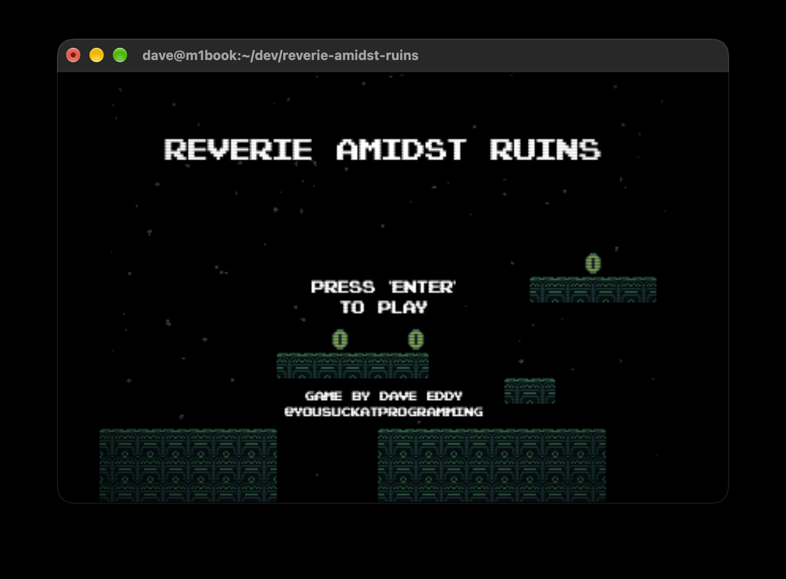
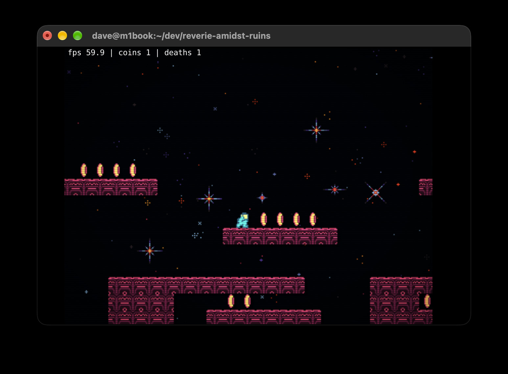
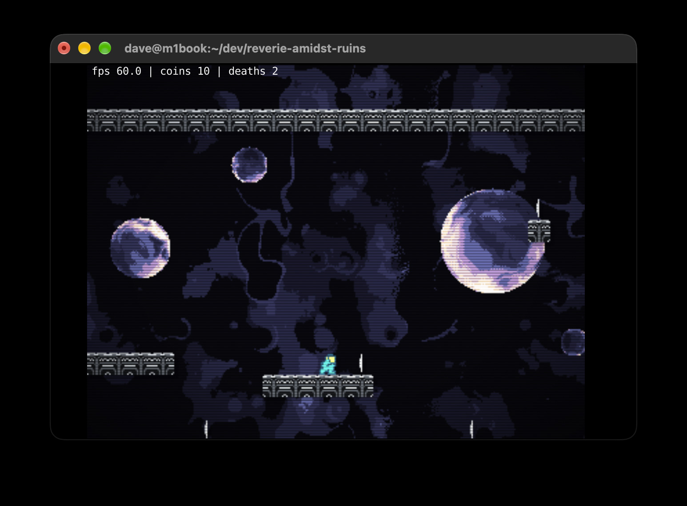

Reverie Amidst Ruins
====================

A simple 2D platformer game to be played directly in the terminal.

How To Play
-----------

Make sure you have [Rust](https://rust-lang.org) installed to compile the source
code, then clone this repo and run it with:

    git clone https://github.com/bahamas10/reverie-amidst-ruins.git
    cd reverie-amidst-ruins
    cargo run --release

Controls
--------

Movement - Keyboard
- `wasd` / `arrows` -  Move player
- `space bar` - Jump
- `enter` - Confirm
- `r` - Restart level (counts as a death)

Movement - Gamepad
- `d-pad` - Move player
- `south button` (`A` / `Cross`) - Jump / confirm
- `start` - Confirm
- `west button` (`X` / `Square`) - Restart level (counts as a death)

Utility
- `num 1` - Toggle post-processing effects
- `num 2` - Save screenshot to current directory
- `num 3` - Randomize level color palette
- `num 8` - Lower master volume by 5%
- `num 9` - Raise master volume by 5%
- `m` - Mute audio
- `-` / `_` - Shrink image by one column
- `+` / `=` - Grow image by one column

How Does This Work?
-------------------

The concept is surprisingly simple - the game logic itself is handled in Rust to
update the player, handle collision, coin collecting, etc.  The "frames" are
then rendered onto an RGBA image completely in memory.  Then, the frame is
zlib compressed and then written to the terminal via the [Kitty Graphics
Protocol](https://sw.kovidgoyal.net/kitty/graphics-protocol/).

- [args.rs](src/args.rs) - CLI arguments
- [audio.rs](src/audio.rs) - Audio Engine (music and SFX)
- [camera.rs](src/camera.rs) - Player-following camera
- [color.rs](src/color.rs) - Helpers to colorize tiles with custom palettes
- [input/mod.rs](src/input/mod.rs) - Own and combine the available input methods
  - [input/keyboard.rs](src/input/keyboard.rs) - Handle keyboard input with
      `crossterm`
  - [input/gamepad.rs](src/input/gamepad.rs) - Handle gamepad input with `gilrs`
- [level.rs](src/level.rs) - Level processing and parsing (levels in [levels/](levels))
- [main.rs](src/main.rs) - Main entry point and game loop
- [player.rs](src/player.rs) - The player and its properties
- [render.rs](src/render.rs) - Render the game frame to an RGBA image
- [screen.rs](src/screen.rs) - Abstractions over "screens" (intro, level, end, etc.)
- [stats.rs](src/stats.rs) - Maintain stats during the game (deaths, playtime, etc.)
- [terminal/mod.rs](src/terminal/mod.rs) - Abstraction over the terminal to handle
      ANSI
  - [terminal/kitty_graphics.rs](src/terminal/kitty_graphics.rs) - Helpers to
      output images to the terminal

Performance
-----------

On my M1 Macbook Pro using iTerm2:

- without `--release`: ~25 fps
- with `--release`: comfortably runs at 144 fps, can go up to ~500 fps

You can test the fps yourself with:

    cargo run --release -- --fps 30
    cargo run --release -- --fps 60
    cargo run --release -- --fps 144

Tested Terminals
----------------

- [iTerm2](https://iterm2.com) on macOS: works perfectly
- [Ghostty](https://ghostty.org) on macOS: works perfectly
- [WezTerm](https://wezterm.org) on macOS: works but choppy visuals (FPS is
    high but the image rendered appears to stutter)

Screenshots
-----------

License
-------

MIT License
